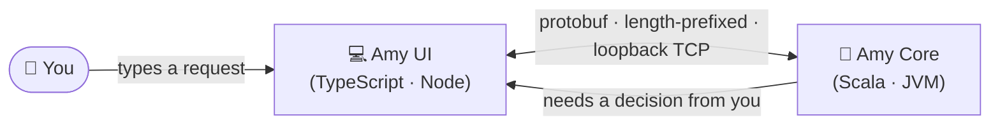

<div align="center">

# 🤖 Amy

**A natural-language command-line agent.**

You type a request in plain English 💬 → Amy breaks it into concrete steps 🧠 → Amy asks before anything risky ⚠️ → the steps run on your machine ✅

<p>
  
  
  
  
</p>

</div>

---

```
$ amy "commit and push all the latest changes"
$ amy "summarize this folder"
$ amy "compress this folder"
```

## 🧩 What Works Today

This project is an early walking skeleton, not a finished agent — here's exactly what's real and running:

- 🔌 A loopback TCP socket between the **Core** (Scala/JVM) process and the **UI** (TypeScript/Node) process — deliberately not stdio, so the UI keeps its own real terminal for rendering and raw keystrokes. See [`ARCHITECTURE.md`](./ARCHITECTURE.md) §1.
- 📦 4-byte length-prefixed protobuf framing on both ends, generated from one shared `.proto` file (ScalaPB on the Core side, protobuf-ts on the UI side)
- 🔁 All three IPC request/response flows wired end-to-end: **Confirmation**, **Access Request**, and **Clarification**
- ✅ Verified by hand, interactively, in a real terminal

Everything past this — actual reasoning, tools, memory — is the roadmap below, not shipped code yet.

## 🏗️ How It Works



Core owns the reasoning and spawns the UI process itself; the UI owns the terminal and renders whatever Core asks it to. Neither process can do the other's job, and they only ever talk over that socket.

Here's a real exchange, captured from an actual run — not a mockup:

```
Amy wants to run:
  git push --force

  This rewrites remote history and can discard other people's commits.

Proceed? [y/n]
```

## 🚀 Installation

**Prerequisites:** ☕ JDK 21+ (GraalVM recommended) · 📦 [sbt](https://www.scala-sbt.org/) 1.10+ · 🟢 Node.js ≥ 22

```bash
git clone https://github.com/jettspanner123/NaturalLanguageCLIManipulatorCodebaseArchitecture.git
cd NaturalLanguageCLIManipulatorCodebaseArchitecture
```

Amy is two separate processes, and the **UI must be built first** — Core launches it as a subprocess:

```bash
# 1. Build the UI (Core spawns this as a child process, so it must exist first)
cd NaturalLanguageCLIManipulatorUserInterfaceMSC
npm install
npm run build

# 2. Run Core — it compiles the protobuf messages, starts the socket,
#    and launches the UI process for you
cd ../NaturalLanguageCLIManipulatorCoreMSC
sbt run
```

## 📜 Scripts

**UI** (`NaturalLanguageCLIManipulatorUserInterfaceMSC/package.json`):

| Script | What it does |
|---|---|
| `npm run generate:ipc` | Regenerates the TypeScript IPC types from the shared `.proto` file |
| `npm run build` | `generate:ipc` + compiles TypeScript to `dist/` |
| `npm start` | Runs the built UI directly (`node dist/Main.js`) — normally launched by Core instead |

**Core** (`NaturalLanguageCLIManipulatorCoreMSC`, via `sbt`):

| Command | What it does |
|---|---|
| `sbt compile` | Regenerates the Scala IPC types (ScalaPB) and compiles |
| `sbt run` | Compiles, starts the socket, and launches the full Core ↔ UI flow |

## ⚙️ Configuration

Nothing is read from disk at runtime yet — there's no configuration to set today. The planned layout, not yet implemented:

```
~/.Amy/
└── Configurations/
    ├── DirectoryPermissions.yaml   # which folders Amy may access, and how
    └── .env                        # API keys (e.g. for the reasoning model)
```

## 🗺️ Roadmap

- 🧠 The actual agent reasoning loop (plain English → concrete steps)
- 🛠️ Structured Tools, with a shell-command fallback
- 🛡️ A Safety Net that flags destructive commands before they run
- 🔐 Permissions persisted to `DirectoryPermissions.yaml`
- 🔎 Memory/recall over past sessions, via local Ollama embeddings
- 📦 Packaging as a single install (GraalVM native-image + Node single-executable)

## 📖 Documentation

- 📘 [`CONTEXT.md`](./CONTEXT.md) — domain glossary (Session, Tool, Permission Grant, …)
- 📐 [`ARCHITECTURE.md`](./ARCHITECTURE.md) — the full planned technical architecture
- 🧭 [`CODING-RULES.md`](./CODING-RULES.md) — coding rules for this project

## 📄 License

MIT — see [`LICENSE`](./LICENSE).

<div align="center">

Made by [Uddeshya Singh](https://github.com/jettspanner123)

</div>
